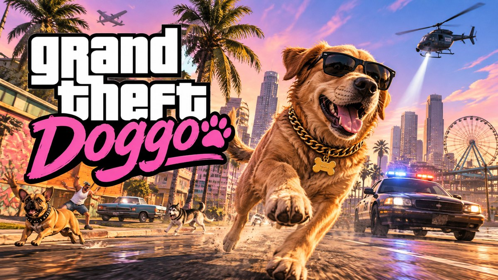

# Grand Theft Doggo

A browser game about being a good dog in a bad city, in a single self-contained HTML
file. A loving parody of a certain open-world crime franchise, told from collar height.

**Play:** https://roberto-ryan.github.io/goodboy/

Unofficial fan parody. Not affiliated with, endorsed by, or sponsored by Rockstar Games
or Take-Two Interactive. Grand Theft Auto is their trademark; this game contains no
assets from it.

## Running locally

Open `index.html` in a browser, or serve the folder with any static server. There is
no build step.

Three.js and the Fredoka font load from public CDNs, so the first load needs a
network connection. The photo textures and the car and character models in `assets/`
load over HTTP, so open the game through a server (for example `python3 -m http.server`)
to see them. Opened straight from the filesystem, the game still runs and falls back
to its procedural surfaces and bodies.

## Assets

Textures from Polyhaven and models from Kenney, both CC0. The key art is original.

## Deploying

Pushing to `main` publishes automatically via GitHub Pages, serving the repository
root.
